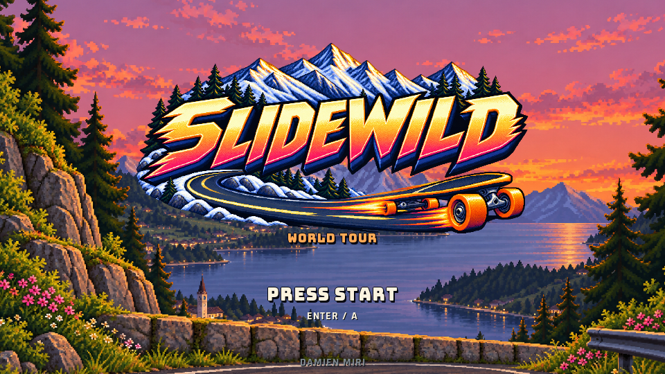

# SLIDEWILD

A retro-inspired arcade longboarding game.
Custom C++20 engine using SDL3 GPU, painted sprites and
perspective terrain.



Eight destinations, four riders, three AI rivals, and a time attack mode.
Arcade physics includes slopes, grip, carving, slides, foot braking and
spinouts, with weather, particles and speed-sensitive camera effects.
All in-game menus, course names, instructions and award graphics are in English.

## Platforms

| Platform | Renderer | Status |
| --- | --- | --- |
| Windows x64 | Direct3D 12 / DXIL | Locally built and tested |
| Mac Apple Silicon | Metal / MSL | ARM64 build and CPU tests verified in CI; GPU validation still required |

The initial Mac deployment target is macOS 11 ARM64; this minimum has not yet
been verified on hardware. Intel Macs and Linux are not supported. Test builds
are unsigned for public distribution. Personal records are not yet persistent.

## Build on Windows

Run PowerShell from the repository root:

```powershell
.\setup.ps1
.\build.ps1
.\Play.cmd
```

Setup downloads pinned w64devkit, SDL3 and DXC releases from upstream and
verifies SHA256 checksums. The initial setup requires Internet access. Tools
stay in the ignored `.tools/` folder. The build script uses CMake, compiles the
game and shaders, checks Metal fingerprints, stages resources and runs seven
C++ test suites plus the shader fingerprint check.

Output: `build/Slidewild.exe`. A Direct3D 12 / Shader Model 6 compatible GPU
and driver are required. `Play Neon.cmd` and `Play Caldera.cmd` open the
corresponding course briefings.

For a custom CMake toolchain, install CMake 3.24+, a C++20 compiler, SDL3 3.4+
and DXC in PATH. Alternatively, `-DDH_FETCH_SDL=ON` builds the bundled SDL source.

```sh
cmake -S . -B build-cmake -DCMAKE_BUILD_TYPE=Release
cmake --build build-cmake --config Release
ctest --test-dir build-cmake -C Release --output-on-failure
```

## Build on Apple Silicon

Install Apple command line tools (`xcode-select --install`) and CMake 3.24+.
In a native ARM64 Terminal:

```sh
bash build-macos.sh
bash test-macos.sh
```

Output: `build-macos/Slidewild.app`. SDL3 is built statically from the pinned
archive in `vendor/`. Generated MSL shaders are included; DXC and SPIRV-Cross
are not required on the Mac. Git attributes preserve their exact bytes and
line endings so their fingerprints remain valid.

See [the Mac build guide](docs/MACOS-BUILD.txt) for native validation and the
limitations of local ad hoc signing.

## Controls

- Left/right arrows or A/D: steer.
- Up/W: tuck; down/S: foot brake.
- Space and a direction: initiate a slide; countersteer to recover.
- Escape/P: pause; F11: fullscreen; N: sound.
- Controller: left stick, triggers, and the bottom face button for slides.

The [player guide](docs/PLAYER-GUIDE.txt) covers menus, results and all controls.
The physics prioritizes arcade handling over exact real-world longboard speeds.

## Validation and distribution

Tests cover camera projection, physics, rivals, scenery geometry, course
coverage, resource paths, animation and music. CPU tests do not replace visual
and controller checks on the target hardware.

GitHub workflows build Windows and Mac ARM64 and run CPU tests. CI artifacts
are not evidence of native GPU validation or Apple notarization.

```sh
python tools/check_repository.py
python tools/package_windows.py
```

Python 3.10+ is sufficient for auditing and packaging. Optional image-authoring
tools use Pillow; wind registration also uses NumPy. Optional music conversion
uses PyAV and NumPy. Playing and building the game require no Python packages.

See [the distribution guide](docs/DISTRIBUTION.md). Executables and ZIP archives
belong in GitHub Releases, outside the source repository.

## Layout

- `src/`, `shaders/`: engine, game, HLSL and generated Metal shaders.
- `assets/`: source PNGs, runtime RGBA artwork, music and fonts.
- `tests/`, `cmake/`, `tools/`: checks, builds and packaging.
- `vendor/`, `licenses/`: pinned SDL3 sources and third-party notices.
- `.tools/`, `build*/`, `dist/`, `media/`, `.local-archive/`: ignored local files.

The 82 PNGs and their RGBA versions are included so builds need no image
conversion tools. RGBA serialization is lossless and can be regenerated with
`python tools/pack_assets.py` (Pillow). Each file is below GitHub's file limit.
Historical artwork prompts and production notes retain their original language.

## Credits and rights

See [CREDITS.md](docs/CREDITS.md) and `licenses/`. No open-source license has
been assigned to the project's code or original artwork. Publishing the sources
does not grant general permission to reuse them.
